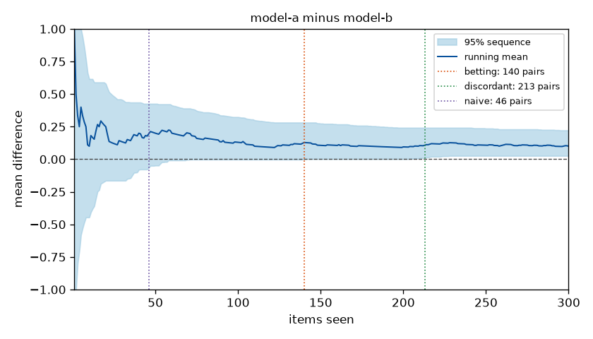
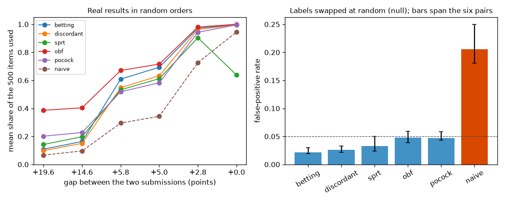

# evalstop

Monitor a running evaluation with intervals and tests that stay valid however often you look, so a run can stop as
soon as the answer is settled.

## Why this is hard

Evaluating an agent is slow and expensive, so people watch the running score and stop when it looks settled. An
ordinary confidence interval or significance test is valid at one sample size fixed in advance. Recomputed after
every item and acted on the first time it looks convincing, it is wrong far more often than its nominal level says,
because each extra look is another chance for noise to cross the line: on the public results used below, an exact
McNemar test repeated after every item declares a winner in 18 to 25 percent of runs in which there is no
difference by construction, against a nominal 5 percent. Stopping early without that inflation needs statements
that hold at all sample sizes at once. Those are necessarily wider than a fixed-sample interval, so the practical
question is how many items the right to look costs.

## Install

```
pip install git+https://github.com/vipul21435/evalstop
```

Python 3.10 or later. The only runtime dependency is numpy. The optional charts need matplotlib:
`pip install "evalstop[plot] @ git+https://github.com/vipul21435/evalstop"`.

## Quickstart

`examples/results.jsonl` holds simulated results (not real data) for two models on 300 items, one JSON object per
line in evaluation order, written by `examples/make_example.py`:

```
{"item": "item-001", "model": "model-a", "score": 1}
```

### One model

Is the pass rate of `model-a` above one half, and when is its interval no wider than 0.2?

```
evalstop monitor examples/results.jsonl --model model-a --threshold 0.5 --width 0.2
```

```
# evalstop monitor

- input: `examples/results.jsonl`, model `model-a`
- scores: 300 in [0, 1], mean 0.7200
- method: betting (hedged capital), alpha 0.05, grid 1000
- 95% confidence sequence after 300 scores: [0.6770, 0.8540]

## Stopping rules

| rule | stopped after | decision | interval at that look |
|---|---|---|---|
| threshold 0.5 | 15 of 300 scores | mean above 0.5 | [0.5110, 1.0000] |
| width <= 0.2 | 186 of 300 scores | narrow enough | [0.6770, 0.8770] |

## Trace

| scores | mean | lower | upper | width |
|---|---|---|---|---|
| 30 | 0.8000 | 0.6050 | 0.9760 | 0.3710 |
| 60 | 0.8000 | 0.6670 | 0.9480 | 0.2810 |
| 90 | 0.7889 | 0.6670 | 0.9290 | 0.2620 |
| 120 | 0.7500 | 0.6770 | 0.9060 | 0.2290 |
| 150 | 0.7200 | 0.6770 | 0.8870 | 0.2100 |
| 180 | 0.7278 | 0.6770 | 0.8790 | 0.2020 |
| 210 | 0.7190 | 0.6770 | 0.8700 | 0.1930 |
| 240 | 0.7167 | 0.6770 | 0.8630 | 0.1860 |
| 270 | 0.7185 | 0.6770 | 0.8580 | 0.1810 |
| 300 | 0.7200 | 0.6770 | 0.8540 | 0.1770 |

The interval holds at every look at once with probability at least 95%, provided the scores arrive in an order unrelated to their values.
```

The threshold question was settled after 15 of the 300 scores. The limits only move inwards, because each reported
interval is the intersection of all intervals so far.

### Two models on the same items

```
evalstop compare examples/results.jsonl --min-effect 0.05 --chart docs/compare_example.png
```

```
# evalstop compare

- input: `examples/results.jsonl`
- A: `model-a`, mean 0.7200; B: `model-b`, mean 0.6200
- pairs: 300, mean difference A - B: +0.1000
- both pass 158, only A 58, only B 28, neither 56
- method: betting (hedged capital), alpha 0.05, grid 1000
- 95% confidence sequence for the difference after 300 pairs: [+0.0260, +0.2220]

## Rules

| rule | valid at every look | stopped after | decision |
|---|---|---|---|
| betting sequence on the difference | yes | 140 of 300 | `model-a` better |
| discordant pairs (sequential McNemar) | yes | 213 of 300 | `model-a` better (final evidence ratio 26.3) |
| exact McNemar at every look | no | 46 of 300 | `model-a` better |
| exact McNemar on all pairs | no | 300 of 300 | `model-a` better (p = 0.00161, valid only as a single look) |

## Trace

| pairs | difference | lower | upper |
|---|---|---|---|
| 30 | +0.1333 | -0.1640 | +0.4560 |
| 60 | +0.2000 | -0.0080 | +0.4140 |
| 90 | +0.1333 | -0.0020 | +0.3360 |
| 120 | +0.0917 | -0.0020 | +0.2840 |
| 150 | +0.1067 | +0.0020 | +0.2740 |
| 180 | +0.1000 | +0.0020 | +0.2560 |
| 210 | +0.1048 | +0.0100 | +0.2420 |
| 240 | +0.1125 | +0.0260 | +0.2420 |
| 270 | +0.1074 | +0.0260 | +0.2300 |
| 300 | +0.1000 | +0.0260 | +0.2220 |
```

The first two rules may be checked after every item. The third row shows what peeking with an ordinary test would
have done: it stops earliest, and its error rate is not 5 percent (see [Results](#results)). `--min-effect` turns on
the futility rule: the run also stops once the interval for the difference lies inside (-0.05, 0.05).



### From Python

`examples/stop_early.py` feeds the differences to the sequence one at a time and stops when it excludes zero:

```python
sequence = BettingCS(alpha=0.05, lo=-1.0, hi=1.0)
for seen, difference in enumerate(pairs.diff, start=1):
    lower, upper = sequence.update(difference)
    if lower >= 0.0 or upper <= 0.0:
        break
```

```
stopped after 140 of 300 items: model-a is better
mean difference so far +0.129, interval [+0.002, +0.282]
```

### Commands

| command | what it does |
|---|---|
| `evalstop monitor FILE` | one model: confidence sequence for the mean score, a threshold rule and a width rule |
| `evalstop compare FILE` | two models on the same items: sequence on the difference, discordant-pair test, futility, McNemar for contrast |
| `evalstop design` | group-sequential boundaries for a planned number of looks |
| `evalstop simulate` | false-positive rate, power and items used by each rule, by seeded simulation |
| `evalstop replay FILE` | the rules over real paired results in random orders, optionally with labels swapped (a null) |

Every command prints Markdown, or JSON with `--format json`. `monitor` and `compare` save a chart with
`--chart FILE`. Input is JSON Lines or CSV with the fields `item`, `model` and `score` (only `score` is required);
`-` reads standard input until it ends. A score is a number between `--lo` and `--hi` (default 0 and 1), a JSON
boolean, or one of the words `true`, `false`, `pass`, `fail`. `evalstop COMMAND --help` lists every option.

## How it works

### Confidence sequences

A confidence sequence is a sequence of intervals `[L_t, U_t]`, one after each score, such that

```
P(L_t <= mu <= U_t for every t) >= 1 - alpha
```

where `mu` is the mean score. Because the statement covers every `t` at once, the interval can be read after every
item and the run stopped at any look without the error rate growing. Both sequences here use the same argument:
for a candidate mean `m`, build a nonnegative process that starts at 1 and is a martingale (or supermartingale)
when `m` is the true mean. By Ville's inequality such a process ever reaches `1 / alpha` with probability at most
`alpha`, so the interval is the set of candidates whose process is still below `1 / alpha`.

**Betting** (`--method betting`, the default). For each candidate `m` on a grid, two wealth processes bet on every
score `x` in [0, 1], one that the mean is above `m` and one that it is below:

```
K+_t(m) = prod_{i<=t} (1 + lam+_i(m) * (x_i - m))        lam+_i(m) = min(lam_i, c / m)
K-_t(m) = prod_{i<=t} (1 - lam-_i(m) * (x_i - m))        lam-_i(m) = min(lam_i, c / (1 - m))

lam_t = sqrt(2 * log(2 / alpha) / (var_{t-1} * t * log(t + 1)))
```

with `c = 1/2` and `var_{t-1}` a running variance estimate from the first `t - 1` scores. A candidate stays in the
interval while `max(K+_t(m), K-_t(m)) / 2 < 1 / alpha`. This is the hedged capital confidence sequence with the
predictable plug-in bet from Ian Waudby-Smith and Aaditya Ramdas, "Estimating means of bounded random variables by
betting", Journal of the Royal Statistical Society Series B 86(1):1-27, 2024
([arXiv:2010.09686](https://arxiv.org/abs/2010.09686), Theorem 3). The bet is larger when the scores vary little,
so the interval adapts to the variance. Each limit is reported at the nearest rejected grid point outside the set,
so the grid can widen the interval but not narrow it.

**Normal mixture** (`--method mixture`). A score in [0, 1] minus its mean is sub-Gaussian with variance proxy 1/4
(Hoeffding's lemma). With `S_t` the sum of the centred scores and `V_t = t / 4`,

```
|S_t| < sqrt((V_t + rho) * log((V_t + rho) / (rho * alpha^2)))   for every t, with probability >= 1 - alpha
```

which is the two-sided normal-mixture boundary, eq. (14) of Steven R. Howard, Aaditya Ramdas, Jon McAuliffe and
Jasjeet Sekhon, "Time-uniform, nonparametric, nonasymptotic confidence sequences", Annals of Statistics
49(2):1055-1080, 2021 ([arXiv:1810.08240](https://arxiv.org/abs/1810.08240)). `rho` is set by their Proposition 3
so that the interval is tightest after `--tune-at` scores (default 200). It is a closed form and cheap to compute,
but it uses the worst-case variance. That makes it a reasonable choice for a pass rate near one half (in the
quickstart example it ends narrower than betting, 0.151 against 0.177 wide, with
`evalstop monitor examples/results.jsonl --model model-a --method mixture`) and a poor one for paired differences,
whose variance is far below the worst case (see [Results](#results)).

### Two models

`compare` pairs the two models by item and works on the differences `d = a - b`, which lie in [-1, 1] for scores in
[0, 1].

**Sequence on the mean difference.** Either sequence above, applied to the differences. The comparison is settled
when the interval excludes 0. With `--min-effect delta` the run also stops for futility at the first look where the
interval lies inside `(-delta, delta)`: no difference of at least `delta` is left to find. Both conclusions come
from the same sequence, so together they are wrong with probability at most `alpha`.

**Discordant pairs.** For pass/fail scores only the discordant pairs carry information about which model is
better, and under "no difference" each of them favours either model with probability 1/2. That is the null of
McNemar's test. With `w` discordant pairs won by A and `l` by B, the likelihood ratio of a win probability `p`
against 1/2 is `(2p)^w * (2(1-p))^l`; averaged over a uniform prior on `p` it is

```
E = 2^(w + l) * w! * l! / (w + l + 1)!
```

Under the null `E` is a nonnegative martingale that starts at 1, so the test rejects the first time `E >= 1 / alpha`
and may be checked after every pair. This is a mixture sequential probability ratio test, the construction behind
the always valid p-values of Ramesh Johari, Leo Pekelis and David J. Walsh, "Always Valid Inference: Bringing
Sequential Analysis to A/B Testing" ([arXiv:1512.04922](https://arxiv.org/abs/1512.04922)).

**Wald's test.** The rule `sprt` in `simulate` and `replay`, and `evalstop.sprt` in Python, implement the
sequential probability ratio test of A. Wald, "Sequential Tests of Statistical Hypotheses", Annals of Mathematical
Statistics 16(2):117-186, 1945 ([doi:10.1214/aoms/1177731118](https://doi.org/10.1214/aoms/1177731118)). To choose
between pass rates `p0` and `p1` with error rates `alpha` and `beta`, follow the log-likelihood ratio and stop when
it leaves `(log(beta / (1 - alpha)), log((1 - beta) / alpha))`. The rule `sprt` runs two such tests on the
discordant pairs, a win rate of 1/2 against `--win-rate` (default 0.65) in each direction at `alpha / 2`, and stops
for futility when both have chosen 1/2. Unlike a confidence sequence it needs the alternative fixed in advance, and
Wald's thresholds bound the false-positive rate by `alpha / (1 - beta)` rather than `alpha`.

**Group-sequential designs.** If the looks are planned in advance, the error rate can be spent over them
(K. K. Gordon Lan and David L. DeMets, "Discrete sequential boundaries for clinical trials", Biometrika
70(3):659-663, 1983, [doi:10.1093/biomet/70.3.659](https://doi.org/10.1093/biomet/70.3.659)). A spending function
`f` with `f(1) = alpha` fixes how much error may be used by the time a share `t` of the items has been seen, and
the critical values follow by numerical integration over the joint normal distribution of the statistics at the
looks. Two spending functions are implemented: `obf`, `f(t) = 4 - 4 * Phi(z_{alpha/4} / sqrt(t))`, which is strict
early and close to the fixed-sample critical value at the end (O'Brien-Fleming type), and `pocock`,
`f(t) = alpha * log(1 + (e - 1) * t)`, which uses about the same critical value at every look (Pocock type).

```
evalstop design --looks 5 --items 500
```

```
# evalstop design

- 5 equally spaced looks, alpha 0.05, two-sided, O'Brien-Fleming type spending

| look | share of items | items | reject when abs(z) >= | nominal p | alpha spent |
|---|---|---|---|---|---|
| 1 | 0.200 | 100 | 4.8769 | 0.00000 | 0.00000 |
| 2 | 0.400 | 200 | 3.3570 | 0.00079 | 0.00079 |
| 3 | 0.600 | 300 | 2.6803 | 0.00736 | 0.00762 |
| 4 | 0.800 | 400 | 2.2898 | 0.02203 | 0.02442 |
| 5 | 1.000 | 500 | 2.0310 | 0.04225 | 0.05000 |

z is the test statistic at that look, for example (wins - losses) / sqrt(wins + losses) over the discordant pairs. The error rate holds only if the data are examined at these looks and nowhere else.
```

The rules `obf` and `pocock` apply these boundaries to the McNemar statistic at equally spaced looks. They rest on
a normal approximation and hold only if the data are examined at the planned looks and nowhere else.

**The naive baseline.** The rule `naive` runs the exact McNemar test after every item (or every `--look-every`
items) and stops the first time its p-value is at most `alpha`. It is here to be measured, not used. `fixed` is the
same test once, after the last item.

### A fixed benchmark is sampled without replacement

A benchmark is a fixed set of `N` items, and a run that works through them in random order sees their scores
without replacement. That matters for what the statements above mean, because there are two different targets.

1. The pass rate on the kind of item the benchmark was drawn from. If the `N` items are regarded as a sample from
   a larger pool, the first `t` items of a random order are `t` independent draws from that pool, every score has
   the same conditional mean, and everything above holds as stated for every `t` up to `N`. This is the usual
   reading of an error bar on a benchmark score, and it is what the default sequences, the discordant-pair test,
   Wald's test and the group-sequential rules address. Their intervals do not shrink to a point at the last item,
   because the pool is larger than the benchmark.
2. The score on exactly these `N` items, which is what a full run would report. That number is fixed, and after
   `t` items it constrains the rest: if the full-benchmark mean is `m`, the next score has conditional mean
   `(N * m - sum so far) / (N - t + 1)`, not `m`. The wealth processes above are then not martingales at the true
   `m`, so their guarantee does not carry over to this target by the same argument.

For the second target, `--population N` (in Python `BettingCS(population=N)`) makes the betting sequence bet
against that conditional mean instead, which restores the martingale (section 5 of Waudby-Smith and Ramdas,
"Betting while sampling without replacement"), and drops candidate means that the scores seen so far make
impossible. The interval then covers the full-benchmark mean at every look and closes on it at the last item. In
the quickstart example, `evalstop monitor examples/results.jsonl --model model-a --population 300` ends at
[0.7190, 0.7210] around the realised 0.72, where the default ends at [0.6770, 0.8540].

The two targets answer different questions. For the second, any nonzero difference between two models is settled
once enough of the benchmark has been seen, however small it is, because nothing is left to chance at the end. The
first asks whether the difference would hold up on new items. `replay` and the study below judge the rules against
a fixed-sample test for the first target. Only the betting sequence has a without-replacement form here.

## Results

### Public SWE-bench Verified submissions

Data: per-instance results of seven submissions in the public
[SWE-bench/experiments](https://github.com/SWE-bench/experiments) repository, folder `evaluation/verified`, read
on 2026-11-13. The repository page shows no licence file, so nothing from it is stored in this repository:
`scripts/fetch_swebench_verified.py` downloads the results and only the numbers below are kept. The seven folders
are named `20260217_mini-v2.0.0_<model>` with the models deepseek-3-2-high, gemini-3-flash-high, glm-5-high,
gpt-5-2-high, gpt-5-mini, kimi-k2-5-high and minimax-2-5-high, and each gives a resolved flag for the same 500
items. They share a date and a scaffold version in their names, so a pair differs in the model. Six pairs were
chosen to span gaps from 19.6 points to none.

For each pair the 500 paired results are put in 2000 random orders and every rule is run on each order. A rule
"decides" when it picks one of the two submissions; an order in which it never decides counts as using all 500
items. In the last table the two labels are also swapped at random within every item, which makes "no difference"
true by construction, so every decision there is a false positive.

```
python scripts/fetch_swebench_verified.py --out verified.jsonl
python scripts/swebench_study.py verified.jsonl --orders 2000 --seed 0 --chart docs/swebench_replay.png
```

Orders per pair: 2000, seed 0, alpha 0.05.

Pairs (resolved items out of 500, gap in points, discordant items, exact McNemar p):

| pair (A vs B) | A | B | gap | only A | only B | p on all 500 |
|---|---|---|---|---|---|---|
| gemini-3-flash-high vs gpt-5-mini | 379 | 281 | +19.6 | 109 | 11 | 1.9e-21 |
| kimi-k2-5-high vs gpt-5-mini | 354 | 281 | +14.6 | 88 | 15 | 9.7e-14 |
| gemini-3-flash-high vs deepseek-3-2-high | 379 | 350 | +5.8 | 47 | 18 | 0.00042 |
| minimax-2-5-high vs kimi-k2-5-high | 379 | 354 | +5.0 | 41 | 16 | 0.0013 |
| glm-5-high vs deepseek-3-2-high | 364 | 350 | +2.8 | 37 | 23 | 0.092 |
| gpt-5-2-high vs glm-5-high | 364 | 364 | +0.0 | 29 | 29 | 1 |

Mean share of the 500 items used (share of orders that reached a decision):

| pair | betting | mixture | discordant | obf | pocock | sprt | naive | fixed |
|---|---|---|---|---|---|---|---|---|
| gemini-3-flash-high vs gpt-5-mini | 0.11 (100%) | 0.46 (100%) | 0.10 (100%) | 0.39 (100%) | 0.20 (100%) | 0.14 (100%) | 0.07 (100%) | 1.00 (100%) |
| kimi-k2-5-high vs gpt-5-mini | 0.16 (100%) | 0.83 (100%) | 0.15 (100%) | 0.40 (100%) | 0.23 (100%) | 0.20 (100%) | 0.10 (100%) | 1.00 (100%) |
| gemini-3-flash-high vs deepseek-3-2-high | 0.61 (91%) | 1.00 (0%) | 0.55 (100%) | 0.67 (100%) | 0.52 (100%) | 0.53 (99%) | 0.30 (100%) | 1.00 (100%) |
| minimax-2-5-high vs kimi-k2-5-high | 0.69 (78%) | 1.00 (0%) | 0.63 (100%) | 0.72 (100%) | 0.58 (100%) | 0.61 (100%) | 0.34 (100%) | 1.00 (100%) |
| glm-5-high vs deepseek-3-2-high | 0.97 (5%) | 1.00 (0%) | 0.96 (6%) | 0.98 (8%) | 0.94 (11%) | 0.90 (7%) | 0.73 (55%) | 1.00 (0%) |
| gpt-5-2-high vs glm-5-high | 1.00 (0%) | 1.00 (0%) | 0.99 (1%) | 1.00 (0%) | 1.00 (1%) | 0.64 (0%) | 0.94 (7%) | 1.00 (0%) |

Share of orders whose conclusion matches the exact McNemar test on all 500:

| pair | betting | mixture | discordant | obf | pocock | sprt | naive | fixed |
|---|---|---|---|---|---|---|---|---|
| gemini-3-flash-high vs gpt-5-mini | 1.000 | 1.000 | 1.000 | 1.000 | 1.000 | 1.000 | 1.000 | 1.000 |
| kimi-k2-5-high vs gpt-5-mini | 1.000 | 1.000 | 1.000 | 1.000 | 1.000 | 1.000 | 1.000 | 1.000 |
| gemini-3-flash-high vs deepseek-3-2-high | 0.914 | 0.000 | 1.000 | 1.000 | 1.000 | 0.994 | 1.000 | 1.000 |
| minimax-2-5-high vs kimi-k2-5-high | 0.783 | 0.000 | 1.000 | 1.000 | 1.000 | 0.998 | 1.000 | 1.000 |
| glm-5-high vs deepseek-3-2-high | 0.953 | 1.000 | 0.945 | 0.919 | 0.885 | 0.931 | 0.453 | 1.000 |
| gpt-5-2-high vs glm-5-high | 0.997 | 1.000 | 0.994 | 1.000 | 0.995 | 1.000 | 0.932 | 1.000 |

False-positive rate with labels swapped at random within each pair:

| pair | betting | mixture | discordant | obf | pocock | sprt | naive | fixed |
|---|---|---|---|---|---|---|---|---|
| gemini-3-flash-high vs gpt-5-mini | 0.021 | 0.000 | 0.025 | 0.043 | 0.045 | 0.042 | 0.250 | 0.037 |
| kimi-k2-5-high vs gpt-5-mini | 0.029 | 0.000 | 0.033 | 0.059 | 0.059 | 0.050 | 0.237 | 0.051 |
| gemini-3-flash-high vs deepseek-3-2-high | 0.021 | 0.000 | 0.027 | 0.045 | 0.044 | 0.026 | 0.180 | 0.040 |
| minimax-2-5-high vs kimi-k2-5-high | 0.019 | 0.000 | 0.025 | 0.038 | 0.043 | 0.024 | 0.186 | 0.032 |
| glm-5-high vs deepseek-3-2-high | 0.020 | 0.000 | 0.026 | 0.050 | 0.043 | 0.025 | 0.190 | 0.024 |
| gpt-5-2-high vs glm-5-high | 0.019 | 0.000 | 0.021 | 0.054 | 0.045 | 0.028 | 0.188 | 0.050 |



Reading the tables:

- For the two pairs 19.6 and 14.6 points apart, the betting sequence and the discordant-pair test settle the
  comparison in every order after 10 to 16 percent of the items.
- For the two pairs 5.8 and 5.0 points apart, the discordant-pair test decides in every order after 55 and 63
  percent of the items on average. The betting sequence decides in 91 and 78 percent of the orders. The mixture
  sequence never decides: its worst-case variance is far too large for these differences.
- For the pair 2.8 points apart, the test on all 500 items is not significant (p = 0.092). The always-valid rules
  pick a winner in 5 to 7 percent of orders and the group-sequential rules in 8 and 11 percent. Peeking with
  McNemar after every item picks one in 55 percent. These are shuffles of one fixed set of results in which the
  two submissions do differ (37 against 23 discordant items), so they are not error rates.
- For the tied pair, peeking declares a winner in 7 percent of orders and every other rule in at most 1 percent.
  Wald's test uses 64 percent of the items there on average, because it stops for futility.
- With labels swapped, peeking is wrong in 18 to 25 percent of orders. The betting sequence (0.019 to 0.029), the
  discordant-pair test (0.021 to 0.033) and Wald's test (0.024 to 0.050) stay at or below 0.05. The
  group-sequential rules range from 0.038 to 0.059 and the single test on all 500 from 0.024 to 0.051; with 2000
  orders the standard error of each entry is about 0.005, and the group-sequential boundaries rest on a normal
  approximation, so they are not guaranteed to stay below alpha.

One pair on its own, with the same numbers as its row above:

```
evalstop replay verified.jsonl --model-a 20260217_mini-v2.0.0_glm-5-high \
    --model-b 20260217_mini-v2.0.0_deepseek-3-2-high --orders 2000 --seed 0
```

This is one benchmark and seven submissions from one scaffold. How early a rule can stop depends on the gap and on
how many items the two models disagree on, so the shares above should not be read as general.

### Simulation

`simulate` draws paired pass/fail results in which the two models disagree on a given share of the items
(`--discordance`, default 0.3) and their pass rates differ by the given effect.

```
evalstop simulate --effects 0 0.05 0.1 --items 500 --runs 5000 --seed 0
```

```
# evalstop simulate

- 5000 runs of 500 paired pass/fail items per effect, seed 0
- the two models disagree on a share 0.3 of the items; the effect is the difference between their pass rates
- alpha 0.05

| effect | rule | valid at every look | false positives | power | futility stops | mean items |
|---|---|---|---|---|---|---|
| 0 | betting | yes | 0.026 | - | 0.000 | 490.5 |
| 0 | mixture | yes | 0.000 | - | 0.000 | 500.0 |
| 0 | discordant | yes | 0.026 | - | 0.000 | 489.9 |
| 0 | obf | planned looks | 0.049 | - | 0.000 | 496.7 |
| 0 | pocock | planned looks | 0.051 | - | 0.000 | 488.3 |
| 0 | sprt | yes | 0.044 | - | 0.930 | 179.1 |
| 0 | naive | no | 0.260 | - | 0.000 | 408.4 |
| 0 | fixed | one look | 0.039 | - | 0.000 | 500.0 |
| 0.05 | betting | yes | 0.002 | 0.200 | 0.000 | 445.0 |
| 0.05 | mixture | yes | 0.000 | 0.001 | 0.000 | 499.9 |
| 0.05 | discordant | yes | 0.003 | 0.238 | 0.000 | 439.1 |
| 0.05 | obf | planned looks | 0.000 | 0.531 | 0.000 | 449.6 |
| 0.05 | pocock | planned looks | 0.001 | 0.449 | 0.000 | 417.0 |
| 0.05 | sprt | yes | 0.001 | 0.335 | 0.569 | 222.3 |
| 0.05 | naive | no | 0.016 | 0.690 | 0.000 | 282.0 |
| 0.05 | fixed | one look | 0.000 | 0.509 | 0.000 | 500.0 |
| 0.1 | betting | yes | 0.000 | 0.780 | 0.000 | 278.2 |
| 0.1 | mixture | yes | 0.000 | 0.085 | 0.000 | 491.0 |
| 0.1 | discordant | yes | 0.001 | 0.879 | 0.000 | 253.1 |
| 0.1 | obf | planned looks | 0.000 | 0.984 | 0.000 | 316.7 |
| 0.1 | pocock | planned looks | 0.000 | 0.966 | 0.000 | 243.6 |
| 0.1 | sprt | yes | 0.000 | 0.859 | 0.123 | 179.4 |
| 0.1 | naive | no | 0.002 | 0.989 | 0.000 | 123.9 |
| 0.1 | fixed | one look | 0.000 | 0.982 | 0.000 | 500.0 |

False positives are decisions for the wrong model (any decision when the effect is 0). Monte Carlo standard error of each share: at most 0.007.
```

With no difference the betting sequence and the discordant-pair test are wrong in 2.6 percent of runs and peeking
in 26 percent. At a 10-point effect the discordant-pair test finds the better model in 88 percent of runs with 253
of the 500 items on average; the test on all 500 has power 0.98 and always uses 500. At a 5-point effect the cost
of being valid at every look shows: power 0.20 and 0.24 against 0.51 for the single test. The group-sequential
designs give up little power (0.53 and 0.45) because they look only five times. Wald's test stops for futility in
93 percent of the null runs and uses 179 items on average there.

## Limitations

- The guarantees need every score to have the same expected value given the earlier ones: items in an order
  unrelated to their difficulty, for example shuffled. A file sorted by difficulty breaks them. `monitor` and
  `compare` warn when the running intersection becomes empty, which is one symptom, but the problem cannot be
  detected in general.
- By default the target is the pass rate on the pool the items came from, not the score on exactly this benchmark;
  see the section on sampling without replacement. Only the betting sequence has a without-replacement form
  (`--population`); the mixture sequence, the discordant-pair test, Wald's test and the group-sequential rules do
  not.
- Items are treated as independent. Benchmarks whose items cluster (several items from one repository or one
  document) need clustered analysis, which is not implemented here.
- The mixture sequence uses the worst-case variance. It never decided for gaps under 6 points in the study above.
  A variance-adaptive mixture or stitched boundary is not implemented.
- The betting sequence uses one bet size, the predictable plug-in. The paper describes other bets that can be
  tighter; they are not implemented. In the simulation above its power is somewhat below the discordant-pair
  test's.
- The discordant-pair test, Wald's test, the group-sequential rules and the McNemar baselines need pass/fail
  scores. For graded scores `compare` and `replay` run only the sequences on the difference.
- The group-sequential boundaries rely on a normal approximation and on looking only at the planned looks. The
  rules use equally spaced looks. `design` prints boundaries but does not compute power or a sample size.
- Wald's thresholds bound the false-positive rate by `alpha / (1 - beta)`, not `alpha`.
- Scores must be bounded with known bounds. Betting limits are multiples of the range divided by `--grid`, and
  each score costs time proportional to `--grid`.
- Standard input is read to its end before anything is printed; there is no live display. For item-by-item use
  call `BettingCS.update` or `MixtureCS.update` from Python.
- Watching several comparisons at once and acting on the first to settle needs a correction for multiplicity,
  which is not provided.

## Development

```
uv sync --extra dev
uv run ruff check
uv run pytest -q --cov=evalstop
```

259 tests, 99 % line and branch coverage of `src/evalstop` on Python 3.12; the suite also passes on Python 3.10
and 3.13. The tests check the mixture boundary against its closed form, numerical integration and scipy's Lambert
W; the betting interval, with and without replacement, against a direct recomputation of the capital; the
vectorised rules against the sequences item by item; Wald's test against his closed-form boundaries, error bounds
and sample-size approximation; the alpha-spending boundaries against scipy's multivariate normal integral and
simulated Brownian paths; and the coverage and false-positive rates of every valid rule by seeded simulation
(at most alpha plus three binomial standard errors, with half a point more for the group-sequential rules).

## Related tools

- [evalstats](https://github.com/vipul21435/evalstats): error bars, paired comparisons and sample-size planning for
  evaluations at a fixed sample size. evalstop is the sequential case.
- [confseq](https://github.com/gostevehoward/confseq): a general library of confidence sequences and uniform
  boundaries (C++ core, Python and R interfaces). evalstop is much smaller and covers only what monitoring an
  evaluation needs.
- [gsDesign](https://github.com/keaven/gsDesign): group-sequential design for clinical trials in R, including
  power and sample size, which `evalstop design` does not compute.

## Licence

MIT, see [LICENSE](LICENSE).

Built by Vipul Raj Jha · https://vipul21435.github.io
